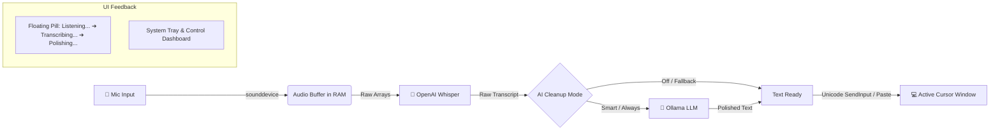

# 🎙️ Resonant

<p align="center">
  <strong>Zero-cloud, hold-to-talk voice dictation for Windows that runs entirely on your local machine.</strong>
</p>

<p align="center">
  <a href="#-quick-start"></a>
  <a href="#-prerequisites"></a>
  <a href="#-architecture"></a>
  <a href="#-architecture"></a>
  <a href="#-privacy--security"></a>
  <a href="LICENSE"></a>
  <a href="https://github.com/y-a-s-h-7/RESONANT/actions/workflows/ci.yml"></a>
</p>

<!-- DEMO GIF PLACEHOLDER
  Hold F9 → speak → release → text appears at the cursor.
  To enable: record a short silent screen capture, save it as docs/assets/demo.gif
  (keep it under ~5 MB), then uncomment the block below and update the alt text.
<p align="center">
  
</p>
-->

---

## 📖 Overview

**Resonant** is a fast, completely offline voice dictation assistant tailored for Windows. Hold down your hotkey (`F9` by default), speak naturally, and release:
1. Audio is recorded straight from your microphone into memory.
2. Transcribed locally using **OpenAI Whisper** (fast in-memory processing; **no FFmpeg required**).
3. Polished and formatted by your local **Ollama** model (corrects spoken slips like *"scratch that"*, formats lists, and removes filler words).
4. Injected directly wherever your cursor is via native Windows Unicode typing or guarded clipboard paste.

**Zero cloud accounts. Zero API keys. Zero telemetry. Audio is never written to disk.**

---

## 📐 Architecture



---

## ✨ Features

- 🔒 **100% Local & Private**: No audio ever touches the cloud or disk. Transcripts are ephemeral unless you explicitly turn on diagnostic logging.
- 🎙️ **Hold-to-Talk & Toggle Modes**: Push-to-talk by default, with a one-tap toggle mode for hands-free dictation or accessibility.
- ⚡ **Hotkey Swallowing**: The hotkey is *designed to* be suppressed from reaching target apps while listening, preventing unintended keystrokes in VS Code, Excel, or browsers (*not yet verified on all apps* — see [Verification status](#-verification-status)).
- 🧠 **Context-Aware AI Polish**: Powered by local Ollama models (e.g. `llama3.2`). Intelligently handles verbal corrections (e.g. *"Tuesday scratch that Wednesday"*), strips awkward fillers, and fixes punctuation.
- 🪟 **Floating Visual Feedback**: An unobtrusive translucent pill appears near your cursor indicating live status (*Listening...*, *Transcribing...*, *Polishing...*).
- 📋 **Guarded Clipboard Injection**: Short text is typed with native Win32 Unicode `SendInput`. Multi-line text is pasted via clipboard with Windows flags *designed to* prevent saving to Windows Clipboard History (`Win+V`) or cloud sync (*not yet verified on all apps*).
- 🔄 **Audio Device Resilience**: Select any input device from the dashboard. If the microphone is unplugged, Resonant seamlessly falls back to the system default microphone.
- 📖 **Custom Vocabulary & Replacements**: Bias Whisper toward technical jargon and acronyms, and configure instant whole-word replacement rules.
- 🩻 **Built-in Diagnostics**: Run `python resonant_cli.py doctor` for an instant audit of audio inputs, Ollama connectivity, Whisper models, and configuration.

---

## ✅ Verification Status

Externally visible claims are verified by hand on real Windows apps. `python resonant_cli.py verify` walks [docs/MANUAL_VERIFICATION.md](docs/MANUAL_VERIFICATION.md), runs the automatable checks itself (keyboard hook install/uninstall, clipboard set/read/restore with the sequence-number guard, Unicode `SendInput` of `é` `’` `—` and an emoji into a temporary window it creates, default microphone), and records pass/fail/skip in `verification_results.json` (gitignored — statuses only, never transcripts or audio). The **Verified on** column is filled from a passing run (date · Windows version); until then the wording above stays in the *designed to … (not yet verified on all apps)* form.

| Claim | Verified by | Verified on (date · Windows) |
|---|---|---|
| Hotkey is swallowed from target apps while listening | `verify` → *Capture & hotkey* | — *(not yet verified on all apps)* |
| `é` `’` `—` and emoji type intact (Unicode `SendInput`) | `verify` automated check | — *(not yet verified on all apps)* |
| Clipboard content is restored after a paste (sequence-number guarded) | `verify` automated check | — *(not yet verified on all apps)* |
| Dictations stay out of `Win+V` history and cloud sync | `verify` → *Injection & clipboard* | — *(not yet verified on all apps)* |

---

## 📋 Prerequisites

- **OS**: Windows 10 or 11 (64-bit)
- **Python**: 3.11 – 3.14 (64-bit)
- **[Ollama](https://ollama.com)**: Installed and running locally
- **Microphone**: Any functional audio input device

> [!NOTE]
> **FFmpeg is NOT required.** Resonant feeds raw audio sample arrays directly to Whisper in memory, bypassing Whisper's reliance on external FFmpeg binaries.

---

## 🚀 Quick Start

### 1. Clone the Repository

```powershell
git clone https://github.com/y-a-s-h-7/RESONANT.git
cd RESONANT
```

### 2. Set Up Virtual Environment & Dependencies

Create and activate a virtual environment, then install runtime dependencies:

```powershell
python -m venv .venv
.\.venv\Scripts\python.exe -m pip install -r requirements.txt
```

> [!TIP]
> `openai-whisper` (imported in code as `whisper`) will be downloaded into `.venv`, and it pulls in **PyTorch (`torch`)** as its own dependency — so both arrive from this one line in `requirements.txt`. A dedicated GPU (NVIDIA CUDA) is automatically utilized by PyTorch and Ollama if available, but CPU inference also runs smoothly with small models.

### 3. Pull a Local Ollama Model

Ensure [Ollama](https://ollama.com) is installed and running, then pull your preferred model:

```powershell
ollama pull llama3.2
```

*(You can also use other models like `phi3`, `mistral`, or `qwen2.5` by changing `ollama_model` in settings).*

### 4. Verify Your Setup

Run the built-in diagnostic doctor:

```powershell
.\.venv\Scripts\python.exe resonant_cli.py doctor
```

This verifies Python packages, microphone devices, Ollama reachability, Whisper model cache, and settings integrity.

### 5. Launch Resonant

Double-click **`run.bat`** or run:

```powershell
.\run.bat
```

*(Alternatively: `.\.venv\Scripts\pythonw.exe resonant.py` for headless background launch).*

The dashboard will open and a tray icon will appear near your taskbar clock. You can close the dashboard window at any time; Resonant remains running in the system tray.

---

## 🎯 Daily Usage

| Action | Result |
|---|---|
| **Hold `F9` anywhere** | Floating pill appears: *Listening…*. Speak, then release the key. |
| **Release `F9`** | Status shifts: *Transcribing…* → *Polishing…* → clean text is injected at cursor. |
| **`F9` while paused** | Passes through normally to the foreground application. |
| **Tray Icon (Double-click)** | Opens the Resonant Dashboard. |
| **Dashboard → Mode** | Switch between **Hold** (push-to-talk) and **Toggle** (tap to start, tap to stop). |
| **Dashboard → Hotkey** | Change dictation key (F1–F12, Pause, Caps Lock). |
| **Dashboard → Microphone** | Select any specific recording input with automatic default fallback. |
| <kbd>Ctrl</kbd> + <kbd>Shift</kbd> + <kbd>Scroll Lock</kbd> | **Emergency Quit** chord (Scroll Lock alone does nothing). |

### Hotkey Swallowing & Windows Integrity (UIPI)

- **Swallowing**: While Resonant is actively listening, the hotkey is *designed to be* suppressed via a low-level keyboard hook so it doesn't trigger actions in the foreground app (*not yet verified on all apps*).
- **Elevated Windows**: Due to Windows User Interface Privilege Isolation (UIPI), standard non-elevated applications cannot intercept or inject keystrokes into windows running as Administrator. Resonant intentionally operates unelevated for security. To dictate into elevated windows (e.g. an Admin PowerShell console), launch Resonant as Administrator.

---

## 🧠 AI Cleanup Examples

When `ai_cleanup_mode` is set to `smart` (default), Resonant evaluates whether LLM processing will improve the text:

| Spoken Audio | Result Injected at Cursor |
|---|---|
| *"the meeting is on Monday scratch that Tuesday at two"* | `The meeting is on Tuesday at 2:00.` |
| *"um I think we should uh proceed with the deployment"* | `I think we should proceed with the deployment.` |
| *"first item review PR second item update docs third item deploy"* | `1. Review PR`<br>`2. Update docs`<br>`3. Deploy` |
| *"Hello world"* *(short phrase with no fillers/corrections)* | `Hello world` *(bypasses LLM for instant response)* |

---

## ⚙️ Configuration

Configuration defaults are defined in `config.py`. Any customizations made in the dashboard or manually are stored in `settings.json`.

> [!NOTE]
> `settings.json` uses a **sparse override pattern**—it only records values that differ from defaults. Deleting `settings.json` resets all settings back to default.

| Setting | Default | Description |
|---|---|---|
| `hotkey` | `"f9"` | Dictation key (`f1`–`f24`, `pause`, `caps_lock`). |
| `hotkey_mode` | `"hold"` | `"hold"` = push-to-talk; `"toggle"` = tap to start, tap again to finish. |
| `swallow_hotkey` | `true` | Suppresses hotkey from target applications while recording. |
| `stt_model` | `"base.en"` | Whisper model: `tiny.en`, `base.en`, `small.en` (or multilingual `base`, `small`). |
| `stt_fp16` | `"auto"` | Half-precision inference: `"auto"` uses fp16 only on a CUDA GPU (≈2× faster); `true`/`false` force it. |
| `ollama_model` | `"llama3.2"` | Model name running in your local Ollama instance. |
| `ai_cleanup_mode` | `"smart"` | `"smart"` = LLM on demand; `"always"` = every phrase; `"off"` = raw Whisper only. |
| `inject_mode` | `"auto"` | `"auto"` = Unicode typing for short single-line, clipboard paste for multi-line. |
| `append_trailing_space` | `true` | Automatically adds a trailing space after typed text. |
| `max_record_seconds` | `120` | Maximum recording safety limit (plays double blip on stop). |
| `min_peak` | `0.01` | Silence gate threshold (lower for quiet microphones). |
| `silence_autostop_ms` | `0` | Auto-stop after this much trailing silence: `0` = off, else `500`–`5000` ms (only after speech; pill shows "Stopped (silence)"). |
| `undo_chord` | `"off"` | Chord + tray item to remove the last dictation: `"off"` (default), `"ctrl+alt+scroll_lock"`, or `"ctrl+alt+pause"`. Ctrl+Z for paste, Backspace × UTF-16 units for typed text, only while the foreground window is unchanged and within 30 s. |
| `ollama_timeout_s` | `10` | Seconds to wait for Ollama before falling back to raw transcript. |
| `input_device` | `null` | `null` for system default, or a specific audio device index. |
| `custom_vocabulary` | `[]` | List of jargon/names to bias Whisper towards (e.g. `["Kubernetes", "PyTorch"]`). |
| `replacements` | `{}` | Whole-word case-insensitive replacement dictionary (e.g. `{"vs code": "VS Code"}`). |
| `log_transcripts` | `false` | When `false`, transcripts are never written to `resonant.log`. |

---

## 🛠️ CLI Utilities

Resonant includes headless CLI utilities via `resonant_cli.py`:

```powershell
# Run system and configuration health check
python resonant_cli.py doctor

# Test Ollama prompt cleanup on a sample string
python resonant_cli.py clean "the meeting is Monday scratch that Tuesday"

# Transcribe an audio file using Whisper
python resonant_cli.py transcribe sample.wav

# Interactive Windows verification walkthrough (writes verification_results.json;
# --list, --auto and --all are available)
python resonant_cli.py verify
```

### Command-Line Launch Flags

| Flag | Description |
|---|---|
| `--hidden` | Starts minimized to system tray without displaying dashboard (used for Windows autostart). |
| `--no-startup` | Bypasses registry check and instance takeover (ideal for development). |
| `--smoke` | Initializes engine, settings, and UI modules, then exits 0 (validation without hardware hooks). |

---

## 🛡️ Privacy & Security

| Surface | Behavior |
|---|---|
| **Audio** | Processed entirely in RAM. **Never** written to disk. |
| **Transcripts** | Ephemeral. Only logged if `log_transcripts: true` is explicitly enabled. |
| **Local Files** | `settings.json` (only overrides), `resonant.log` (rotation at 512 KB), `.vt.lock` / `.vt.pid` (instance locks), `verification_results.json` (verification statuses only — no transcripts or audio). |
| **Clipboard** | When pasting multi-line text, existing clipboard content is preserved and restored. Content is marked with Windows flags (`CanIncludeInClipboardHistory=0`, `CanUploadToCloudClipboard=0`) *designed to* prevent saving to `Win+V` history or cloud sync (*not yet verified on all apps*). |
| **Network** | Strictly local: `http://localhost:11434` (Ollama) and standard Whisper model download upon first run. Zero external calls, zero telemetry. |

---

## 🧰 Troubleshooting

| Issue | Resolution |
|---|---|
| **Hotkey does not respond** | Check system tray icon. If grey, right-click and select *Start listening*. Verify model loaded in tray tooltip. |
| **"AI cleanup unavailable" notice** | Ensure Ollama is running (`ollama serve`). Resonant gracefully falls back to raw Whisper transcripts in the meantime. |
| **Text typed twice** | Check Windows Task Manager for duplicate `pythonw.exe` instances and terminate them. |
| **Nothing typed after speaking** | Verify microphone input in the dashboard. Check if `min_peak` is set too high for your microphone. |
| **Text injected into wrong app** | If you Alt-Tab during processing, Resonant detects the window change, aborts typing, and places text safely on your clipboard. |
| **Antivirus alert** | Low-level keyboard hooks and simulated inputs can trigger heuristic alerts. Add a local exclusion or run through the python script directly. |

---

## 🧪 Development & Testing

Resonant is built with automated testing that decouples business logic from hardware and OS APIs:

```powershell
# Install development dependencies (lightweight; does not require torch)
.\.venv\Scripts\python.exe -m pip install -r requirements-dev.txt

# Run linter
.\.venv\Scripts\python.exe -m ruff check .

# Run test suite (219 tests covering engine, settings, injector, recorder,
# verification, and UI)
.\.venv\Scripts\python.exe -m pytest -m "not ollama"

# Run smoke test
.\.venv\Scripts\python.exe resonant.py --smoke
```

### Benchmarking LLM Prompts

You can benchmark different Ollama models and prompt variations:

```powershell
.\.venv\Scripts\python.exe bench_editor.py --runs 3
```

Results are saved to `bench_results/` (automatically gitignored).

---

## 📂 Repository Structure

```
├── resonant.py          # Application entrypoint, instance locking, tray & UI lifecycle
├── resonant_engine.py   # Dictation pipeline facade (hotkey -> recorder -> Whisper -> Ollama -> injector)
├── resonant_ui.py       # Tkinter dashboard, floating cursor pill, and pystray tray icon
├── resonant_cli.py      # Headless CLI tools (doctor, clean, transcribe)
├── hotkey.py            # Low-level keyboard hook, polling fallback, and emergency chords
├── recorder.py          # PyAudio/sounddevice microphone capture and silence trimming
├── transcriber.py       # OpenAI Whisper inference and silence/hallucination gating
├── editor.py            # Local Ollama client with truncation & refusal guards
├── injector.py          # Win32 SendInput Unicode typing and guarded clipboard paste
├── settings.py          # Settings schema, validation, migrations, and sparse persistence
├── config.py            # Default configuration and system prompt definitions
├── platform_win.py      # Abstracted Win32 platform layer for clean testability
├── startup.py           # Windows Run registry entry management
├── logging_setup.py     # Thread-safe rotating logging configuration
├── bench_editor.py      # LLM benchmark harness
├── run.bat              # Quick launcher with automatic .venv detection
├── verification.py      # Manual + automated Windows verification walkthrough
├── CONTRIBUTING.md      # PR checklist + GitHub repo setup checklist
├── .github/workflows/   # CI: ruff + pytest on Windows (Python 3.11 & 3.13)
├── tests/               # Comprehensive unit and integration test suite
└── docs/                # Roadmap, verification checklists, and docs/archive/
```

---

## 📄 License

This project is licensed under the [MIT License](LICENSE).
